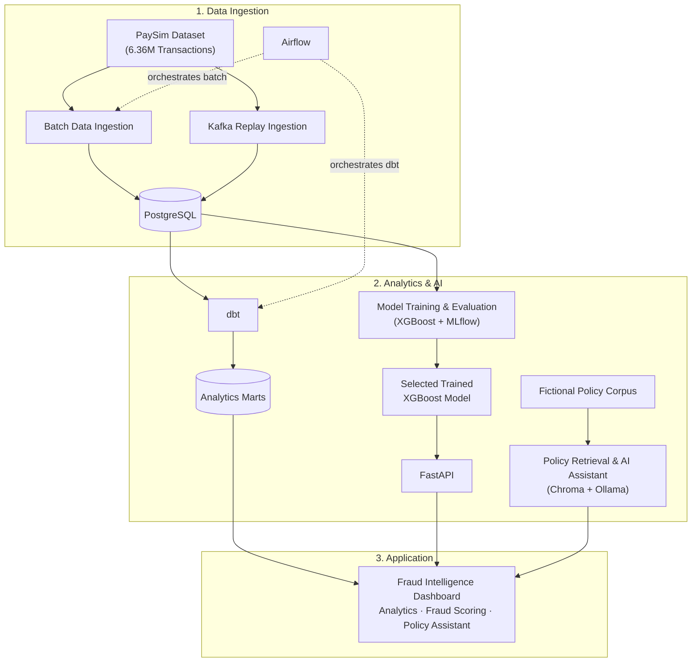

# Financial Fraud Intelligence Platform

[](https://github.com/Zu2iphe3/financial-fraud-intelligence-platform/actions/workflows/python-tests.yml)

An end-to-end data and AI portfolio platform that processes **6,362,620 synthetic
PaySim mobile-money transactions**, builds trusted fraud analytics, evaluates a
leakage-safe XGBoost model, serves reproducible risk scores, and answers questions from
a fictional fraud-policy knowledge base.

The project demonstrates how data engineering, analytics engineering, machine learning,
model serving, local retrieval-augmented generation, orchestration, and an analyst-facing
application can work together without presenting a portfolio system as a production
fraud decision engine.

## What the platform does

- Loads PaySim into PostgreSQL in validated, idempotent chunks.
- Replays the same source rows through Kafka to demonstrate event delivery, consumer
  validation, ingestion auditing, and duplicate-safe persistence on the
  `paysim.transactions.v1` topic.
- Uses dbt to create tested staging, intermediate, and analytics marts.
- Uses Airflow to orchestrate PostgreSQL readiness, batch ingestion, reconciliation,
  and the dbt build. Kafka intentionally remains outside this batch DAG.
- Builds chronological, leakage-safe behavioural features using only activity strictly
  before each transaction's PaySim hour.
- Compares interpretable baselines with XGBoost and records experiment/model-selection
  provenance in local MLflow.
- Serves the final approved XGBoost bundle through FastAPI. Runtime inference does not
  require the historical MLflow database.
- Uses local sentence-transformer embeddings, Chroma retrieval, and Ollama to answer
  only from the fictional policy corpus, with application-controlled source metadata.
- Presents historical analytics, point-in-time transaction scoring, policy guidance,
  and independent service health in a multi-page Streamlit dashboard.
- Runs Python, PostgreSQL, Kafka, FastAPI, dbt, Compose, and secret-scanning checks in
  GitHub Actions.

## Implemented architecture



For transaction scoring, Streamlit retrieves the selected transaction and its historical
activity from PostgreSQL, reconstructs leakage-safe point-in-time behavioural features,
and sends the model-ready vector to FastAPI. FastAPI applies the already-trained XGBoost
model and returns the probability and risk result for Streamlit to display. Model training
and runtime inference are separate: the model is never retrained during prediction and
remains portfolio decision support rather than a production-approved fraud system.

[View the detailed implemented architecture and system boundaries](docs/ARCHITECTURE.md).

Important boundaries:

- Kafka is a controlled ingestion/replay path; it is **not** the live model-inference
  path.
- Airflow orchestrates the historical batch and dbt pipeline; it does not orchestrate
  Kafka, model training, RAG, or application serving.
- MLflow records experimentation and selection evidence; FastAPI loads the separately
  versioned approved model bundle at runtime.
- Streamlit reconstructs model-ready features for a selected historical transaction
  through the reviewed point-in-time service. There is no deployed online feature store.

## Machine-learning methodology and results

The whole-day chronological split prevents a model from learning from future simulated
activity:

| Partition | PaySim days | Rows | Fraud rows |
|---|---:|---:|---:|
| Train | 1–18 | 6,008,416 | 4,857 |
| Validation | 19–24 | 192,778 | 1,516 |
| Held-out test | 25–31 | 161,426 | 1,840 |

PaySim balance fields, fraud labels, flagged-fraud labels, raw identifiers, the current
step, and future activity are prohibited predictive inputs. The final 20-feature
contract combines amount/type with strictly earlier destination behaviour. Behavioural
features improved validation PR-AUC from **0.296950** for the original feature-limited
XGBoost model to **0.487886** for the tuned v2 model.

The final model and threshold were frozen using validation data before one held-out
test evaluation:

| Held-out population | PR-AUC | ROC-AUC | Precision | Recall | F1 |
|---|---:|---:|---:|---:|---:|
| Days 25–31, 161,426 rows | **0.539848** | **0.957729** | **0.289325** | **0.752717** | **0.417987** |

PR-AUC and ROC-AUC describe ranking; precision, recall and F1 use the frozen validation
threshold `0.49207180738449097`. These synthetic-data results support portfolio review,
not an approved real-world fraud policy. See [model training and evaluation](docs/MODEL_TRAINING.md)
and [behavioural feature evidence](docs/MODELLING_DATASET_V2.md).

## Quick start

The authoritative Windows/PowerShell setup, validation, and safe-shutdown sequence is
in [Portfolio setup and local runbook](docs/PORTFOLIO_SETUP.md).

At a high level:

```powershell
git clone https://github.com/Zu2iphe3/financial-fraud-intelligence-platform.git
cd financial-fraud-intelligence-platform
py -3.12 -m venv .venv
.\.venv\Scripts\Activate.ps1
python -m pip install -r requirements.txt
Copy-Item .env.example .env
```

Download PaySim from its original Kaggle page, configure local-only values in `.env`,
then follow the runbook for the database, analytics, streaming, API, RAG, and dashboard.
The raw CSV, real `.env`, databases, MLflow state, Chroma index, and other generated
service state must remain local.

### Reproducibility boundaries

| Component | Release status |
|---|---|
| Approved FastAPI scoring bundle | Versioned in this repository with a checked SHA-256; normal inference does not need local MLflow history. |
| PaySim data and PostgreSQL/dbt state | Reproducible from the separately downloaded synthetic CSV; the CSV and generated database state are not distributed. |
| Kafka replay | Verified on `paysim.transactions.v1`; demonstrates duplicate-safe ingestion into PostgreSQL and is not the live scoring path. |
| Policy assistant | Rebuilt locally from the included fictional corpus; downloaded embeddings, Chroma state, and the Ollama model remain local. |
| MLflow experiment history | Local development evidence only and intentionally not distributed; the selected scoring bundle and reviewed metrics are documented independently. |
| Airflow orchestration | Reproducible through Compose for the batch ingestion/reconciliation/dbt workflow; not required by FastAPI inference. |

## Portfolio screenshots

These are genuine local runs against the implemented platform. They show synthetic
PaySim activity, fictional policy guidance, and portfolio model evidence—not a live
financial institution or production fraud system.

### Analyst experience


| Historical transaction scoring | Grounded policy guidance |
|---|---|
| [](docs/screenshots/02-transaction-risk-scoring.png) | [](docs/screenshots/03-policy-assistant-grounded-answer.png) |

The Policy Assistant presents application-controlled retrieval metadata separately from
the generated answer. [View the verified fictional-policy source cards](docs/screenshots/12-policy-assistant-sources.png).

### Engineering evidence

| Successful batch orchestration | Local experiment comparison |
|---|---|
| [](docs/screenshots/04-airflow-successful-dag.png) | [](docs/screenshots/05-mlflow-model-comparison.png) |

[View the complete screenshot evidence gallery](docs/screenshots/README.md), including
transaction-type analytics, aggregate tables, feature reconstruction, validation versus
held-out test evidence, verified RAG sources, and the privacy-cropped selected MLflow run.

## Documentation

| Area | Primary documentation |
|---|---|
| Release setup | [Portfolio setup and local runbook](docs/PORTFOLIO_SETUP.md) |
| Data provenance and EDA | [Data dictionary](docs/DATA_DICTIONARY.md), [EDA findings](docs/EDA_FINDINGS.md), [notebook](notebooks/01_paysim_exploration.ipynb) |
| PostgreSQL and ingestion | [PostgreSQL setup](docs/POSTGRES_SETUP.md), [PaySim ingestion](docs/PAYSIM_INGESTION.md) |
| Streaming | [Kafka replay pipeline](docs/KAFKA_STREAMING.md) |
| Analytics and orchestration | [dbt analytics](docs/DBT_ANALYTICS.md), [Airflow runbook](docs/AIRFLOW_RUNBOOK.md) |
| ML methodology | [Dataset contract](docs/MODELLING_DATASET_V2.md), [model training](docs/MODEL_TRAINING.md), [learning notes](docs/ML_FRAUD_DETECTION_LEARNING_NOTES.md) |
| Serving and application | [FastAPI scoring](docs/PREDICTION_API.md), [Streamlit dashboard](docs/STREAMLIT_DASHBOARD.md) |
| RAG | [Knowledge base](docs/FRAUD_POLICY_KNOWLEDGE_BASE.md), [local RAG assistant](docs/RAG_ASSISTANT.md) |
| Attribution | [Dataset and model attribution](docs/DATASET_AND_MODEL_ATTRIBUTION.md) |

## Automated platform validation

Pull requests targeting `main` and pushes to `main` run two visible checks:

- **Platform tests (Python 3.12):** validates complete Compose configuration, installs
  dependencies with caching, checks and compiles dbt, starts temporary PostgreSQL and
  Kafka, and runs the complete pytest collection including enabled service integrations.
- **Secret scan (Gitleaks):** scans complete Git history with read-only permissions and
  safe reporting.

Hosted CI intentionally does not ingest the full PaySim CSV, execute a data-populated
dbt build, retrain models, start Airflow/Streamlit, or download Ollama and embedding
models. Those resource-heavy paths are validated through the local release runbook.

On Windows, keep pytest temporary files inside the repository:

```powershell
python -m pytest --basetemp=.pytest_tmp/pytest
```

## Limitations and responsible use

- PaySim is synthetic and does not establish performance on real financial activity.
- Fraud labels are historical evaluation truth; a model probability is not proof of
  fraud and is presented only as decision support for human review.
- Policy documents are original, fictional portfolio material and are not legal or
  operational advice.
- The platform has no production authentication, authorization, encrypted secret store,
  continuously updated online feature service, monitoring/SLA, or deployment approval.
- Local Ollama, embeddings, Chroma, PostgreSQL, Kafka, and Airflow require developer
  machine resources and explicit setup.

## Data, attribution, and license

The raw PaySim CSV is not redistributed. Obtain it from the
[original Kaggle PaySim1 listing](https://www.kaggle.com/datasets/ealaxi/paysim1).
PaySim and the derived approved model are attributed separately in
[Dataset and model attribution](docs/DATASET_AND_MODEL_ATTRIBUTION.md).

Original project source code and original documentation are licensed under the
[MIT License](LICENSE). Third-party datasets, derived artifacts, libraries, and tools
remain subject to their respective terms.
