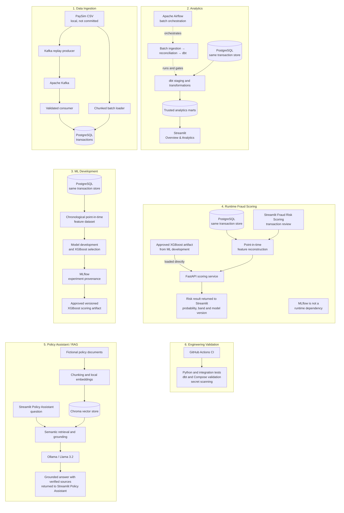

# Detailed implemented architecture

This diagram expands the compact [README architecture](../README.md) into the
implemented data, analytics, machine-learning, runtime-scoring, policy-assistant, and
engineering-validation paths.

Repeated PostgreSQL nodes refer to the same transaction database viewed from different
workflows. The **Approved versioned XGBoost scoring artifact** in ML development and the
**Approved XGBoost artifact from ML development** in runtime scoring are the same
versioned `paysim_fraud_model_v2_scoring` bundle. FastAPI loads that bundle directly;
MLflow is experiment and model-selection provenance, not a runtime dependency.

## System boundaries

- Batch ingestion and Kafka replay both persist the same deterministic PaySim
  transaction identities to PostgreSQL. Kafka does not perform fraud inference.
- Airflow orchestrates the batch ingestion, reconciliation, and dbt workflow only. It
  does not orchestrate Kafka, model training, RAG, or application serving.
- dbt analytics marts serve the Overview & Analytics experience. They are separate
  from the point-in-time behavioural feature reconstruction used for scoring.
- MLflow records offline experiments and selection evidence. Runtime FastAPI scoring
  loads the approved repository-versioned model bundle without connecting to MLflow.
- Fraud Risk Scoring reconstructs leakage-safe features from strictly earlier
  transaction history before calling FastAPI.
- The local policy assistant uses only the fictional policy corpus, Chroma retrieval,
  and Ollama generation. It neither trains nor changes the fraud model.
- GitHub Actions validates repository configuration, contracts, automated tests, and
  secret safety; it is not part of the transaction or inference flow.
