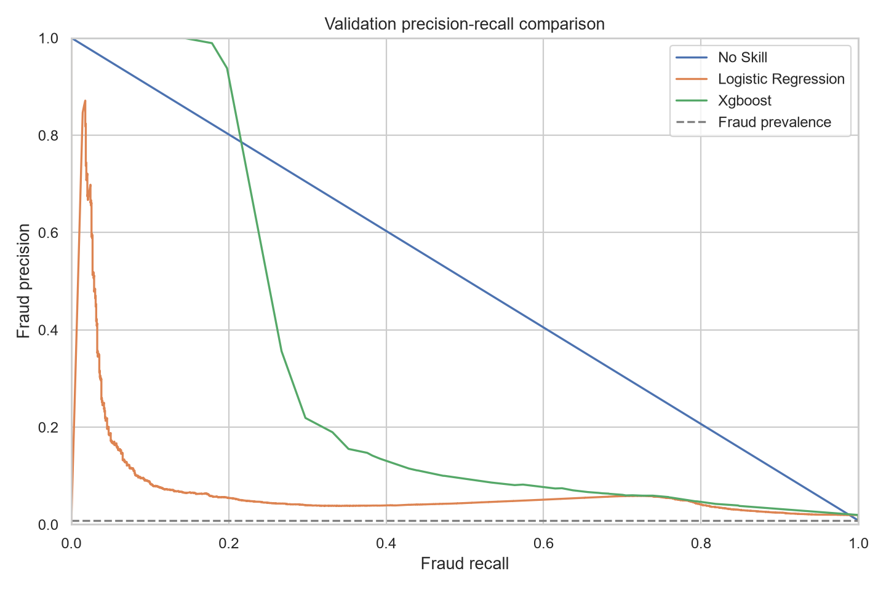
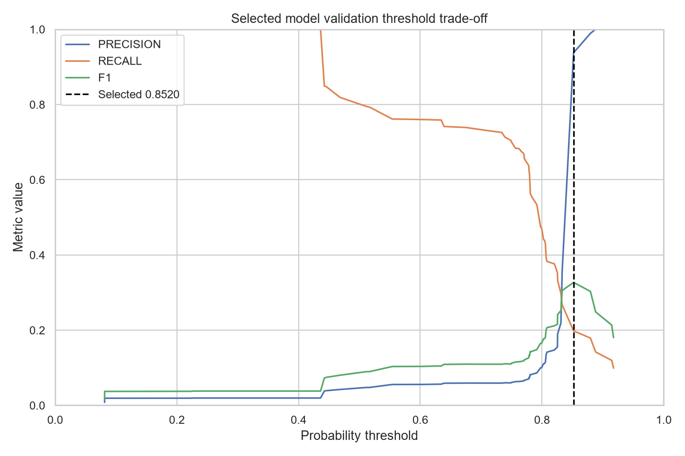
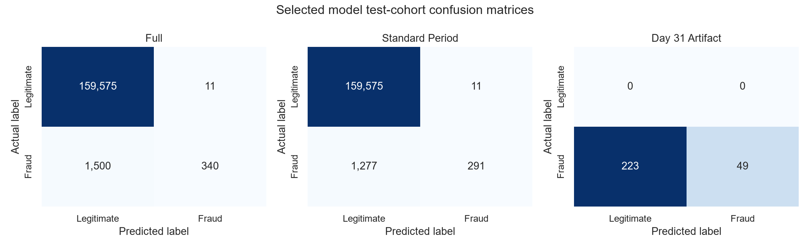

# Fraud model training, selection, and evaluation

## Purpose

PH7-02 trains a no-skill benchmark, an interpretable logistic-regression baseline,
and XGBoost against the exact `paysim_features_v1` contract. It compares candidates on
validation data, locks the winner and threshold before reading test data, tracks the
runs in MLflow, and persists one deployable preprocessing-and-model bundle.

This phase does not prove that the chosen model or threshold is ready for a real fraud
operation. PaySim is synthetic, the approved feature set is intentionally small, and
the financial cost of false positives versus missed fraud has not been specified.

## Test-history clarification

Earlier v1 PH7-02 work evaluated the test partition. That v1 test information was not
used to select or tune the behavioural v2 model. Final v2 feature selection and XGBoost
tuning used train and validation data only. After promotion, the frozen v2 artifact and
unchanged validation threshold were evaluated once on the chronological test partition.
Those results were not used to revise the model, features, tuning, or threshold.

## Protected inputs and chronological data

Training reuses [the PH7-01 feature contract](../config/features/paysim_v1.json) and
its six features without recreating the transformation differently. Balance fields,
balance-derived calculations, identifiers, labels, existing fraud flags, and time
fields remain prohibited predictive inputs.

| Partition | Days | Rows | Fraud | Fraud rate |
|---|---:|---:|---:|---:|
| Train | 1–18 | 6,008,416 | 4,857 | 0.080837% |
| Validation | 19–24 | 192,778 | 1,516 | 0.786397% |
| Test | 25–31 | 161,426 | 1,840 | 1.139841% |

The training imbalance is 1,236.06 legitimate transactions per fraud transaction.
Logistic regression therefore uses balanced class weights and XGBoost uses a
training-derived `scale_pos_weight` of 1,236.06. Rows are neither discarded nor
synthetically duplicated.

## Candidate selection

Validation PR-AUC is the primary ranking metric because fraud is rare and accuracy can
hide a model that detects nothing. PR-AUC alone does not demonstrate a useful fraud
model: fraud precision, recall, F1, false negatives, false positives, and confusion
matrices are mandatory decision evidence. ROC-AUC is secondary and accuracy is
informational only.

At threshold 0.5 the no-skill benchmark predicts every validation transaction as
legitimate. It obtains 99.213603% accuracy while missing all 1,516 fraud cases. This is
why accuracy cannot select a model.

Each candidate's threshold below is the validation threshold that maximizes fraud F1:

| Candidate | PR-AUC | ROC-AUC | Precision | Recall | F1 | False positives | False negatives |
|---|---:|---:|---:|---:|---:|---:|---:|
| No-skill | 0.007864 | 0.500000 | 0.007864 | 1.000000 | 0.015605 | 191,262 | 0 |
| Logistic regression | 0.074576 | 0.892209 | 0.058630 | 0.728232 | 0.108523 | 17,726 | 412 |
| XGBoost | **0.279343** | 0.922432 | 0.937500 | 0.197889 | **0.326797** | 20 | 1,216 |

XGBoost is selected because it has the highest validation PR-AUC. Its stronger PR-AUC
means it ranks fraud more effectively than the alternatives on this validation period;
it does not make every possible threshold operationally good.



## Threshold decision

The persisted validation recommendation is `0.851950`. It maximizes validation F1,
but its high precision comes with low recall: it detects 300 fraud cases and misses
1,216. The following alternatives make the trade-off explicit:

| Operating point | Threshold | Precision | Recall | F1 | False positives | False negatives |
|---|---:|---:|---:|---:|---:|---:|
| At least 95% recall | 0.436203 | 0.019296 | 1.000000 | 0.037861 | 77,050 | 0 |
| Fixed 0.50 | 0.500000 | 0.047363 | 0.794855 | 0.089398 | 24,237 | 311 |
| At least 75% recall | 0.634478 | 0.056202 | 0.758575 | 0.104650 | 19,312 | 366 |
| At least 50% recall | 0.791563 | 0.086018 | 0.533641 | 0.148155 | 8,596 | 707 |
| Maximum F1 | **0.851950** | **0.937500** | 0.197889 | **0.326797** | **20** | 1,216 |
| Fixed 0.90 | 0.900000 | 1.000000 | 0.119393 | 0.213318 | 0 | 1,335 |

The abrupt precision change is caused by this small feature set assigning many rows
similar scores. Maximizing F1 is a reproducible neutral rule when business costs are
unknown, but detecting only about one fifth of fraud may be unacceptable. The stored
threshold is therefore a validation recommendation, not an approved production fraud
policy. A future business decision must state the acceptable missed-fraud and analyst-
review costs before changing it.



## Locked test evaluation

Only the selected XGBoost model and its locked `0.851950` threshold were evaluated on
test data:

| Test cohort | Rows | Fraud | Precision | Recall | F1 | False positives | False negatives | PR-AUC | ROC-AUC |
|---|---:|---:|---:|---:|---:|---:|---:|---:|---:|
| Full test | 161,426 | 1,840 | 0.968661 | 0.184783 | 0.310361 | 11 | 1,500 | 0.314236 | 0.917117 |
| Standard period, days 25–30 | 161,154 | 1,568 | 0.963576 | 0.185587 | 0.311230 | 11 | 1,277 | 0.301623 | 0.918447 |
| Day 31 artifact | 272 | 272 | 1.000000 | 0.180147 | 0.305296 | 0 | 223 | Not informative | Undefined |

Day 31 has no legitimate transactions. Its precision cannot express false-positive
behaviour, PR-AUC would be trivially perfect, and ROC-AUC is undefined. Only detected
fraud, recall, and false negatives are useful for that artifact cohort. The standard
period is the primary generalization view.



## Frozen behavioural-v2 held-out evaluation

The later behavioural-v2 model was selected and tuned using train days 1-18 and
validation days 19-24 only. After promotion, the exact persisted
`paysim_fraud_model_v2_tuned_review` artifact and frozen `0.49207180738449097`
threshold were evaluated once on test days 25-31.

| Population | Rows | Fraud | PR-AUC | ROC-AUC | Precision | Recall | F1 | FP | FN |
|---|---:|---:|---:|---:|---:|---:|---:|---:|---:|
| Validation/model selection | 192,778 | 1,516 | 0.487886 | 0.962215 | 0.344041 | 0.706464 | 0.462735 | 2,042 | 445 |
| Held-out test | 161,426 | 1,840 | 0.539848 | 0.957729 | 0.289325 | 0.752717 | 0.417987 | 3,402 | 455 |

PR-AUC and ROC-AUC are threshold-independent. Precision, recall, F1, false positives,
and false negatives use the frozen threshold. The test evidence did not trigger any
model or threshold change. Detailed standard-period and Day 31 cohort results are in
[`MODELLING_DATASET_V2.md`](MODELLING_DATASET_V2.md).

## MLflow and persisted artifact

The local MLflow SQLite database and run artifacts live under ignored `mlruns/`. Each
candidate run records model parameters, seed, dependency versions, feature-contract
identity, source fingerprint, validation metrics, threshold tables, model explanation,
and estimator. The selected run also records the three test cohorts.

The ignored `artifacts/models/paysim_fraud_model_v1/` directory contains:

- the selected estimator;
- the exact PH7-01 transformer contract;
- the selected threshold;
- a versioned raw-input schema;
- the MLflow run ID and package versions;
- evaluation tables and figures.

The reload parity check produced a maximum absolute probability difference of `0.0`.

## Reproduce locally

Generate the PH7-01 dataset first, then run:

```powershell
python -m src.models.train_paysim_models
```

The command refuses to overwrite an existing model directory. For a separate manual
run, choose another ignored output:

```powershell
python -m src.models.train_paysim_models `
  --artifact-root artifacts/models/paysim_fraud_model_v1_manual
```

Open the local MLflow interface with:

```powershell
$mlflowDatabase = (Resolve-Path .\mlruns\mlflow.db).Path -replace '\\', '/'
mlflow ui --backend-store-uri "sqlite:///$mlflowDatabase"
```

Then open `http://127.0.0.1:5000` and review the
`paysim-fraud-paysim_features_v1` experiment.

Run the focused automated checks with the Windows-friendly temporary directory:

```powershell
python -m pytest `
  tests/test_model_data.py `
  tests/test_model_evaluation.py `
  tests/test_model_artifact.py `
  tests/integration/test_model_training_integration.py `
  --basetemp=.pytest_tmp/ph7-02
```
