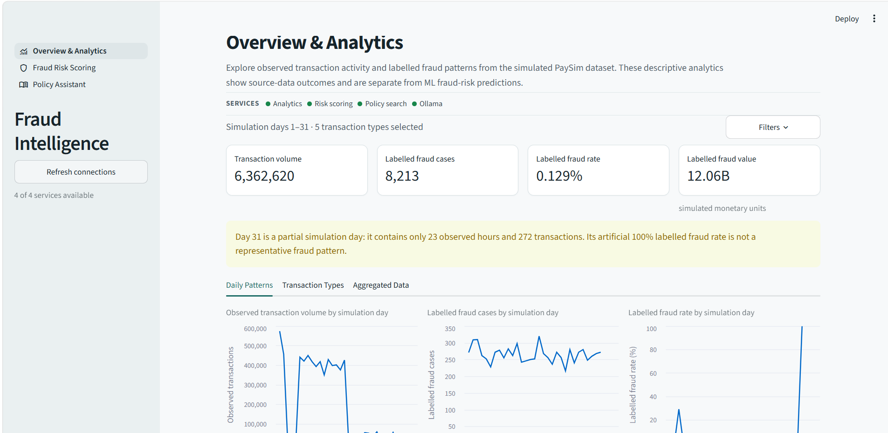
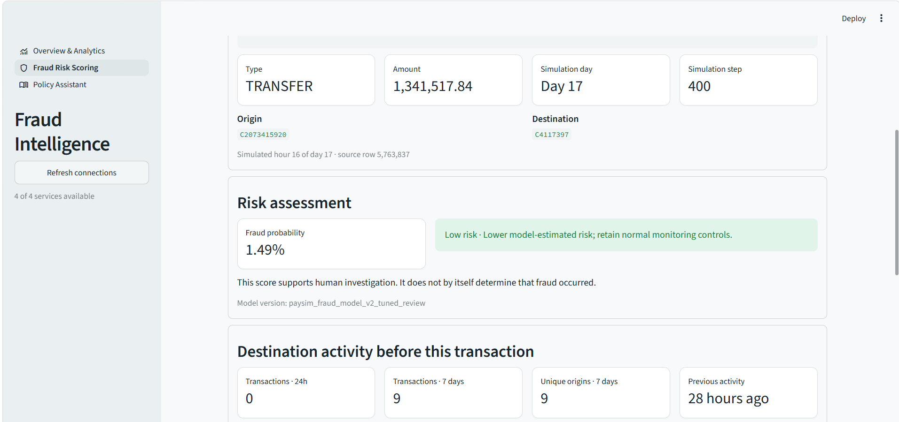
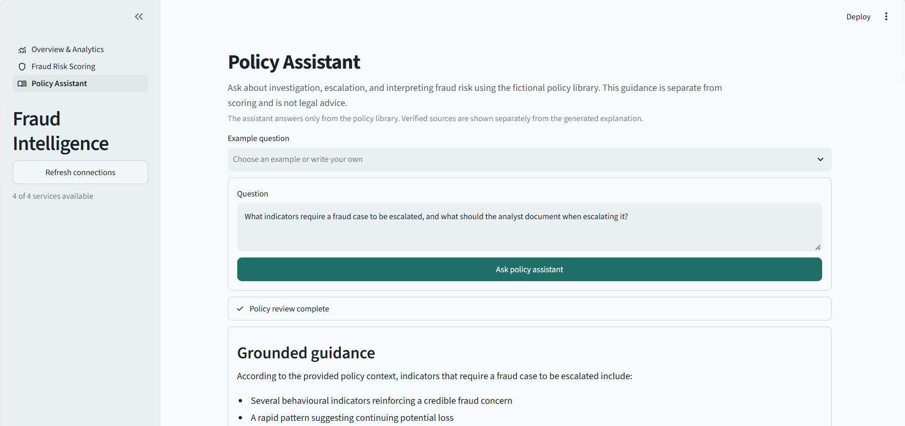
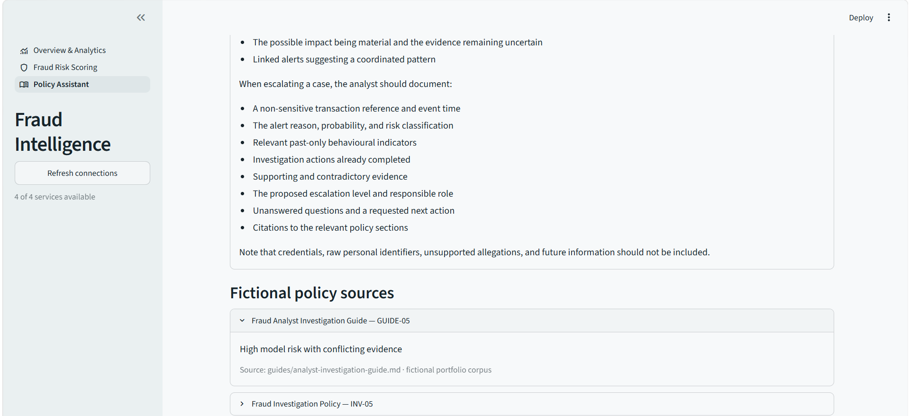
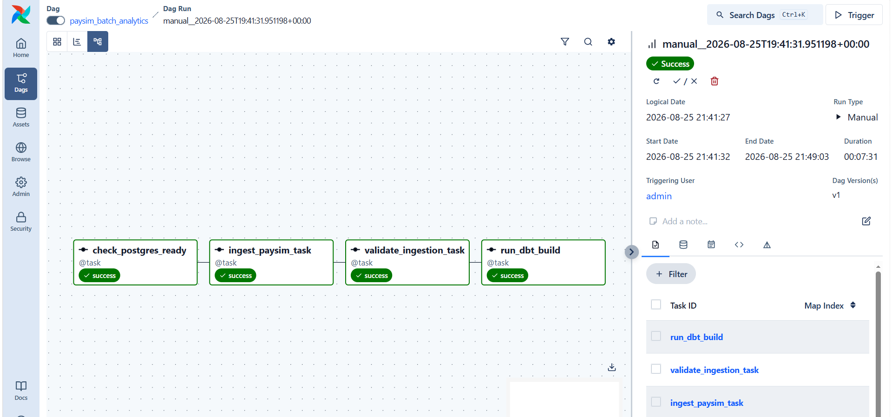
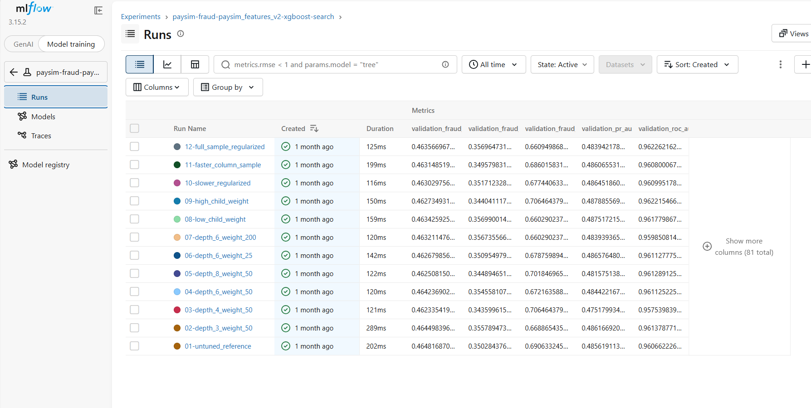

# Portfolio screenshot evidence

These screenshots were captured from genuine local platform runs. Only deterministic
cropping was applied to remove browser chrome, operating-system UI, the Windows
activation watermark, and the MLflow panel that exposed a local username and filesystem
path. Application values, metrics, model results, and pipeline states were not edited.

PaySim is synthetic, policy documents are fictional, MLflow history is local-only, and
none of these images represents a production-approved fraud decision system.

## Main portfolio evidence

### Overview and Analytics

The dashboard reads trusted dbt marts and clearly separates labelled historical outcomes
from model predictions. Day 31 is identified as a partial simulation artifact.

### Historical transaction risk scoring

A real PostgreSQL transaction is reconstructed from activity strictly before its
simulation hour, scored by the versioned XGBoost model through FastAPI, and presented as
human decision support.

### Policy Assistant

The first capture shows a supported question and grounded response from the fictional
policy corpus. The application-controlled retrieval sources are shown separately below.

The expanded source card identifies the retrieved fictional document, section
`GUIDE-05`, passage title, and repository-relative corpus path. Additional retrieved
sections remain visible as collapsed source cards. These identifiers come from retrieval
metadata rather than language-model-generated prose.

### Airflow orchestration

The `paysim_batch_analytics` DAG completed PostgreSQL readiness, idempotent ingestion,
reconciliation, and the dbt build successfully.

### MLflow experiment comparison

The local-only MLflow history compares the controlled XGBoost search candidates and
their validation metrics. MLflow is experiment provenance, not a runtime API dependency.

## Additional review evidence

| Evidence | Screenshot |
|---|---|
| Labelled fraud by transaction type | [Overview transaction-type charts](06-overview-transaction-types.png) |
| Trusted daily and transaction-type marts | [Overview aggregate tables](07-overview-aggregate-tables.png) |
| Real PostgreSQL transaction discovery | [Transaction selection](08-transaction-selection.png) |
| Read-only model features and feature contract | [Model features and contract](09-model-features-and-contract.png) |
| Validation and final held-out evidence | [Validation and held-out metrics](10-model-validation-and-held-out-test.png) |
| Selected local MLflow run metrics | [Privacy-cropped selected run](11-mlflow-selected-run-metrics.png) |
| Application-verified RAG source attribution | [Policy Assistant source cards](12-policy-assistant-sources.png) |

## Privacy and integrity review

- No credentials, tokens, email addresses, local filesystem paths, or personal usernames
  are visible in the repository images.
- Localhost URLs and the generic Airflow `admin` user are environment/service context,
  not secrets.
- Cropping preserves the genuine captured application output; no metric or result was
  reconstructed or fabricated.
- The selected-run capture intentionally omits MLflow's machine-specific source panel.
